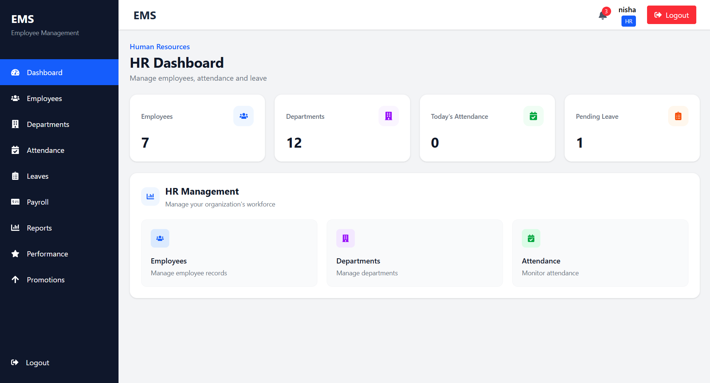
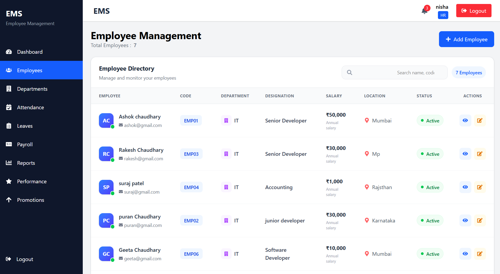
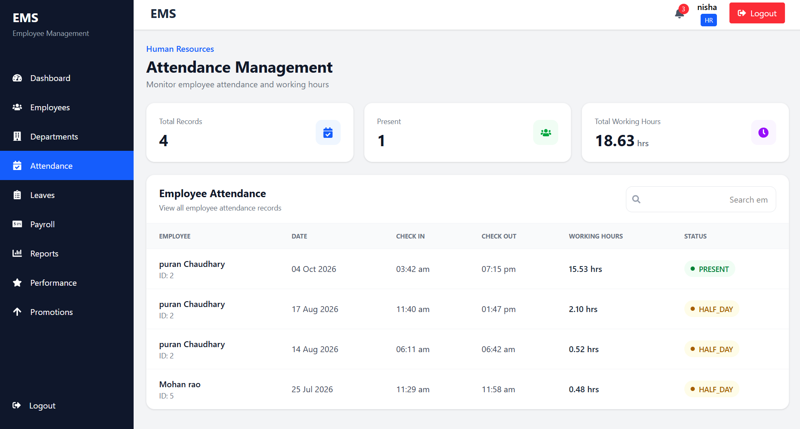
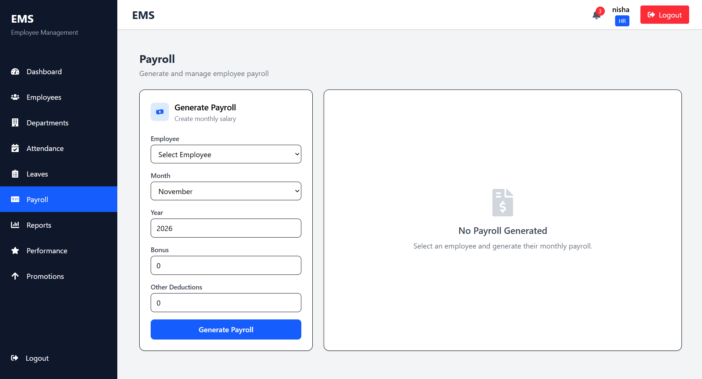
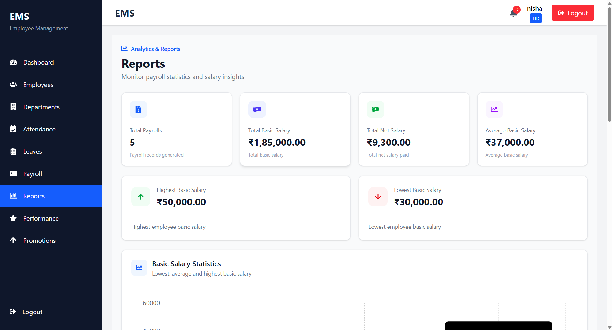

# Employee Management System (EMS)

A full-stack Employee Management System built using **React.js, Spring Boot, Spring Security and PostgreSQL**. The application helps organizations manage employees, departments, attendance, leave requests, payroll and HR operations through role-based access.

## 🚀 Project Overview

The Employee Management System is designed to simplify HR operations by providing a centralized platform for employee administration and workforce management.

The application uses a React frontend connected to a Spring Boot REST API backend, with PostgreSQL for persistent data storage.

## 🛠️ Technology Stack

### Frontend
- React.js
- JavaScript
- HTML5
- CSS3 / Tailwind CSS
- Axios
- React Router
- Recharts
- React Icons

### Backend
- Java
- Spring Boot
- Spring Security
- JWT Authentication
- Spring Data JPA
- Hibernate
- REST APIs
- Lombok

### Database
- PostgreSQL

### Development Tools
- Eclipse IDE
- Visual Studio Code
- Postman
- Git and GitHub

## ✨ Main Features

### Authentication & Authorization
- User login and authentication
- JWT-based authentication
- Role-based access control
- Admin, HR and Employee roles

### Employee Management
- Create employee records
- View employee details
- Update employee information
- Manage employee profiles

### Department Management
- Create departments
- View departments
- Update department information
- Delete departments (authorized roles)

### Attendance Management
- Employee check-in and check-out
- Attendance records
- Attendance monitoring

### Leave Management
- Apply for leave
- View leave requests
- Approve or reject leave requests
- Track leave status

### Payroll Management
- Generate employee payroll
- Calculate salary based on attendance and approved leaves
- Apply bonuses and deductions
- Generate payslips

### Reports & Analytics
- Payroll statistics
- Total payroll records
- Total salary paid
- Average salary
- Highest and lowest salary
- Salary statistics visualization

### Additional Modules
- Performance management
- Promotion management

## 🏗️ Project Architecture

The application follows a layered backend architecture.

```text
Employee Management System
│
├── Frontend
│   ├── React Components
│   ├── Pages
│   ├── Services
│   ├── API Integration
│   └── Routing
│
├── Backend
│   ├── Controller
│   ├── Service
│   ├── Repository
│   ├── Entity
│   ├── DTO
│   ├── Mapper
│   ├── Security
│   └── Exception Handling
│
└── Database
    └── PostgreSQL
```

## 🔐 Security

- JWT-based authentication
- Spring Security configuration
- Role-based endpoint authorization
- Password encoding
- Stateless session management

## ⚙️ Running the Project Locally

### Prerequisites

- Java 17 or compatible configured project JDK
- Node.js and npm
- PostgreSQL
- Git

### 1. Clone the repository

```bash
git clone https://github.com/sunilchaudhary00186-tech/EMS.git
```

```bash
cd EMS
```

### 2. Backend Setup

Navigate to the backend folder:

```bash
cd Backend
```

Configure your PostgreSQL database and application properties.

Set the required database credentials in your local configuration. Do not commit passwords or secrets to GitHub.

Run the Spring Boot application from Eclipse or using the project's Maven wrapper, if available.

Backend default URL:

```text
http://localhost:8080
```

### 3. Frontend Setup

Open another terminal:

```bash
cd Frontend
```

Install dependencies:

```bash
npm install
```

Start the React development server:

```bash
npm run dev
```

Frontend default URL:

```text
http://localhost:5173
```

## 📂 Repository Structure

```text
EMS/
│
├── Backend/
│   └── Spring Boot Application
│
├── Frontend/
│   └── React Application
│
├── README.md
└── LICENSE
```

## 👨‍💻 Developer

**Sunil Chaudhary**

B.Sc. Computer Science

Interested in Java Full Stack Development, Spring Boot, React.js and Backend Development.

## 📌 Future Improvements

- Advanced reporting and analytics
- Monthly payroll visualization
- Exportable reports
- Improved dashboard analytics
- Application deployment

---
## 📸 Project Screenshots

### HR Dashboard


### Employee Management


### Attendance


### Payroll


### Reports

⭐ If you find this project useful, feel free to explore the repository.
